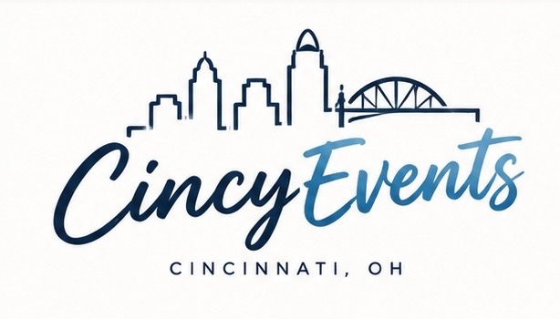
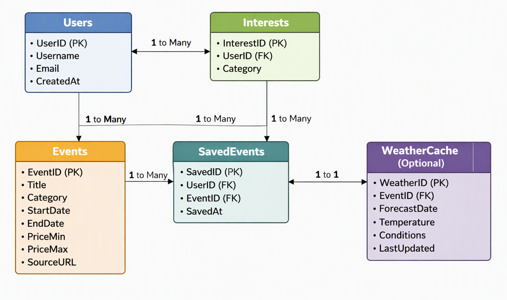

# IS7024-Final-Project
# Cincy Events

## Introduction

Cincy Events is a personalized event discovery and planning web application designed to help users explore activities and experiences throughout Cincinnati. The application combines information from multiple data sources to recommend local events based on users' interests, budgets, preferred dates, and locations.

Users can receive personalized event recommendations based on their saved preferences or manually search and filter events to discover new experiences.

### Key Features

- **Personalized Recommendations:** Discover events based on saved interests and preferences.
- **Event Search:** Browse local events by category, including music, sports, food, arts, and entertainment.
- **Budget Filtering:** Find activities within a selected spending limit.
- **Date and Location Filtering:** Search for events based on availability and preferred locations.
- **Event Details:** View event dates, venues, descriptions, available pricing, and ticket links.
- **Saved Events:** Bookmark events for future planning.
- **Weather Information:** View available weather forecasts when planning outdoor activities.

## Application Logo

## Storyboard

## Requirements
#### Requirement 1: Search for Events
###### Scenario
As a user who is interested in sports, I want to be able to search sporting events on any name related to the topic: sports, team names, sport names, etc.
###### Dependencies
Recent or upcoming sport events search data should be available and accessible.
###### Assumptions
Search results should be events that has not happened yet.
###### Examples
1.1
**Given** an upcoming hockey game is available
**When** I search for "Cincinnati Cyclones"
**Then** I should receive at least one result with these attributes:

Event: Cincinnati Cyclones
 

Date: Nov 25

Time: 7:05 PM

Location: Heritage Bank Center

Ticket: $38+

1.2 
**Given** an upcoming football game is available
**When** I search for "Cincinnati Bearcats"
**Then** I should receive at least one result with these attributes:

Event: Cincinnati Bearcats Football

Date: Nov 21

Time: 12:00 PM

Location: Nippert Stadium

Ticket: $47+

1.3
**Given** an upcoming baseball game is available
**When** I search for "Reds"
**Then** I should receive at least one result with these attributes:

Event: Cincinnati Reds

Date: Apr 13

Time: TBD

Location: Great American Ball Park

Ticket: $181+

#### Requirement 2: Filter Events by Budget
###### Scenario
As a user who is finding events to attend based on budget, I want to be able to search for different events with the filter function including options like <$50, $50-100, or >$100, etc.
###### Dependencies
Recent or upcoming events search data should be available and accessible with the respective filtered price.
###### Assumptions
Search results should be events that has not happened yet.
CUrrency should be in USD.
###### Examples
2.1
**Given** a festival that does not require ticket is available
**When** I filter events with pricing "<$50"
**Then** I should receive at least one result with these attributes:

Event: The 2026 Cincinnati SantaCon

Date: Dec 12

Time: 12:00 PM

Location: Downtown Cincinnati, OTR, Mt.Adams, Covington, Newport, and Factory 52

Ticket: Free

2.2 
**Given** an upcoming event with the ticket price greater than $100 is available
**When** I filter events with pricing ">$100"
**Then** I should receive at least one result with these attributes:

Event: Haunted Fest

Date: Oct 31

Time: 7:00 PM

Location: MegaCorp Pavillon

Ticket: $110+

#### Requirement 3 
Event Search and Filtering
###### Scenario:
As a user, I want to search for events by category so I can find events that match my interests.
###### Dependencies:
Events should be up to date, and categories should be consistent. 
###### Assumptions: 
Events have sufficient data, users use meaningful search terms, and location matching is flexible.
###### Examples:
3.1 
**Given** the database tags events as "sports", "arts", and "music". 
**When** I filter by "arts"
**Then** I should only receive events tagged with "arts"

3.2 
**Given** I search for "concerts"
**When** the system finds five events with "concert" in the title or description
**Then** all five events should appear in the results

#### Requirement 4: Save Events for Later

###### Scenario
As a user, I want to save events that interest me so that I can easily find them later without having to search for them again.

###### Dependencies
Event information must be available from the application's data sources, and the database must store saved events associated with a user.

###### Assumptions
Users must be logged in to save events.
Saved events should remain accessible when users return to the application.

###### Examples

4.1

**Given** I am logged into my account and an upcoming Cincinnati Cyclones game on November 25 is displayed in my search results

**When** I click the "Save Event" button

**Then** the Cincinnati Cyclones game should be added to my saved events list and display a confirmation message saying "Event Saved."

4.2

**Given** I previously saved the Cincinnati Cyclones game on November 25

**When** I navigate to the "Saved Events" page

**Then** I should see the Cincinnati Cyclones game listed with its date, time, location, and available ticket price.

4.3

**Given** I have already saved the Cincinnati Cyclones game on November 25

**When** I attempt to save the same event again

**Then** the application should prevent a duplicate entry and display a message saying "This event is already saved."

4.4

**Given** the Cincinnati Cyclones game on November 25 is currently in my saved events list

**When** I click the "Remove" button

**Then** the event should disappear from my saved events list without affecting other saved events.

4.5

**Given** I am browsing events without being logged into an account

**When** I click the "Save Event" button

**Then** the application should redirect me to the login page without saving the event.

## Data sources
Cincy Events integrates multiple real‑world Cincinnati event feeds to provide accurate, up‑to‑date information. This feed will be used through a JSON parser to populate our event listings.
### 1. Washington Park Events Feed
Source: https://washingtonpark.org/events  
Washington Park maintains an active events archive and upcoming events calendar. This data source provides:
- Event titles
- Dates and times
- Categories (music, fitness, community events, etc.)
- Venue details
- Event descriptions
- Pricing or registration information

### 2. Fountain Square Events Feed
Source: https://myfountainsquare.com/events  
Fountain Square hosts concerts, festivals, skating events, and seasonal activities. This data will be merged with Washington Park’s feed to create a unified event catalog.
Their events feed provides:
- Event names
- Dates and schedules
- Event categories
- Venue and location details
- Ticket or registration links
- Descriptions and promotional details

### 3. Cincinnati CityBeat Events
Source: https://www.citybeat.com/events  
CityBeat offers a broader set of local events across Cincinnati, including arts, nightlife, food, and community activities. This feed expands the variety of events available to users beyond the major venue calendars.
This source provides:
- Event titles
- Categories
- Dates and times
- Venue information
- Descriptions
- 
### 4.Ticketmaster Discovery API

Source: [https://developer.ticketmaster.com/products-and-docs/apis/discovery-api/v2/](https://developer.ticketmaster.com/products-and-docs/apis/discovery-api/v2/)

Ticketmaster provides a RESTful API containing information about upcoming concerts, sporting events, comedy shows, and other entertainment activities. This data source provides:

- Event titles
- Dates and times
- Categories (music, sports, theater, comedy, etc.)
- Venue names and locations
- Event descriptions
- Ticket prices (when available)
- Ticket purchasing links

## Database

## Team Composition
- **Team Member:** Taylor Johnson, Noah Owens, Hayden Phan, Angel Paz
- **Meeting Time:** Mondays 2PM-4PM (In person/Teams)
