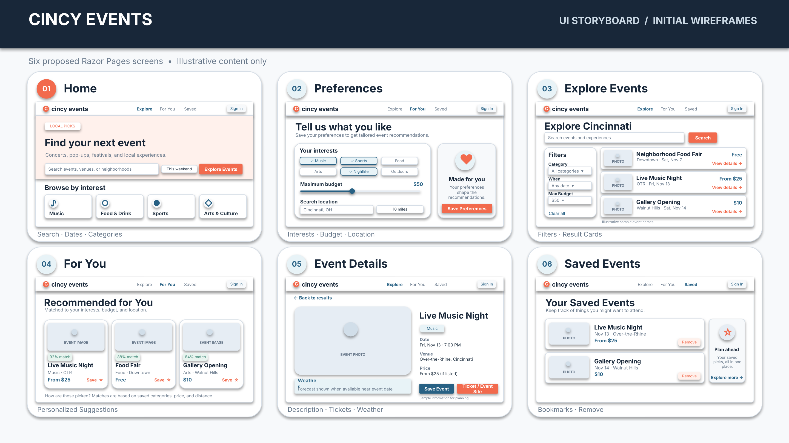

# IS7024-Final-Project
# Cincy Events

## Introduction

Cincy Events is a personalized event discovery and planning web application designed to help users explore activities and experiences throughout Cincinnati. The application combines information from multiple data sources to recommend local events based on users' interests, budgets, preferred dates, and locations.

Users can receive personalized event recommendations based on their saved preferences or manually search and filter events to discover new experiences.

### Key Features

- **Personalized Recommendations:** Discover events based on saved interests and preferences.
- **Event Search:** Browse local events by category, including music, sports, food, arts, and entertainment.
- **Budget Filtering:** Find activities within a selected spending limit.
- **Date and Location Filtering:** Search for events based on availability and preferred locations.
- **Event Details:** View event dates, venues, descriptions, available pricing, and ticket links.
- **Saved Events:** Bookmark events for future planning.
- **Weather Information:** View available weather forecasts when planning outdoor activities.

## Application Logo

## Storyboard

